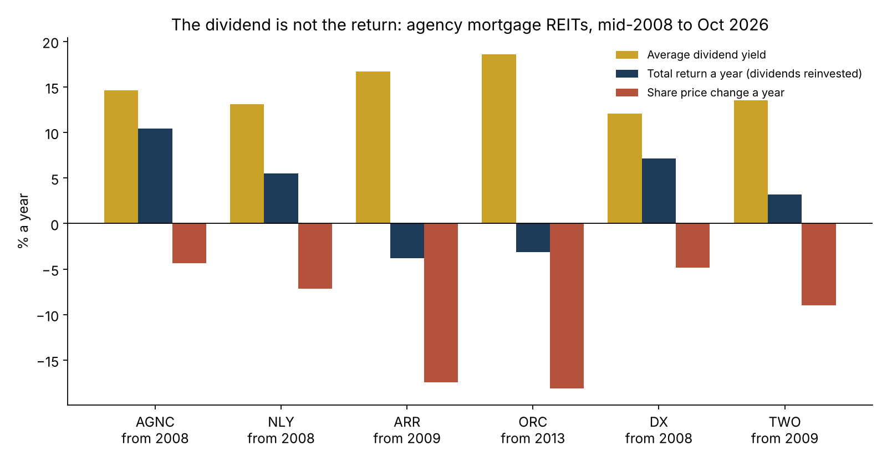

# Is a 15% dividend a 15% return? Agency mortgage REITs, 2008–2026

Agency mortgage REITs pay some of the highest dividend yields in the US market, and income investors buy them for it. This project asks what holders actually earned, what the shares really are underneath (stock-market risk, rate risk, or a short position in rate volatility), and whether a rule fixed in advance on rate volatility would have helped. Weekly data, June 2008 to 30 October 2026.

## Results

- **The dividend is not the return.** Across six agency mortgage REITs (AGNC, NLY, ARR, ORC, DX, TWO), the dividend yield averaged 14.8% a year, but total return with dividends reinvested averaged 3.2% a year and share prices fell 10.1% a year. Dividends per share were cut 54% to 95% at five of the six; only DX held its payout.
- **Underneath, it is equity plus a bond.** An equal-weight basket had a stock-market beta of 0.95 (0.64 in 2008–2016, 1.24 in 2017–2026) and lost about 6.5% for each 1-point rise in the 10-year yield, like a 6.5-year bond. The pre-registered negative-convexity test failed: the squared yield change has the wrong sign (+0.03, t = 0.6). Weekly, the shares did not lose more in big rate moves than duration explains.
- **The damage is regime-level.** Out of sample (2017 to Oct 2026), the basket earned 11.0% a year annualised in weeks when trailing 13-week rate volatility was at or below its long-run median, and −0.5% when it was above. Holding it only in calm-rate periods (T-bills otherwise, 10 bp a switch) returned 7.1% a year vs 0.2% for holding, with a −20% vs −64% maximum drawdown. In 2010–2016 the same rule added nothing (8.5% vs 8.9%).
- **Fragile, so a risk dial, not a strategy.** Only 13 switches in the test; 2020 and 2022 drive much of the gain (excluding 2020: 5.0% vs 1.4%). An 8-week lookback gives 8.1%, 26 weeks 4.6%, and 52 weeks fails (−0.6%).



## The commercial case

| Element | What it is |
|---|---|
| Who pays | Wealth platforms, RIAs and income funds that hold mortgage REITs, BDCs and other high-yield equity |
| The problem | Holders read the dividend yield as the return; here it overstated the return by about 11.6 points a year |
| The product | An income-quality monitor: total return vs yield, dividend-per-share trend, factor decomposition and a rate-volatility regime flag, refreshed weekly |
| Proof | 18 years of weekly data; the rule fixed before testing; 2017–2026 held out |
| Build vs buy | 2–3 weeks on public data; today most platforms screen on yield alone |
| Pricing logic | $30–50k a year per platform (illustrative): on a $100m allocation, the test-period drawdown gap was $44m |
| Adoption risk | Income buyers anchor on yield; the KPI is drawdown and total-return shortfall vs yield |

## Method

1. Daily split-adjusted closes and dividends (ex-dates) → weekly total returns (Friday to Friday). Each name enters once it has a full week of prices; ARR is used from 2010, after its SPAC merger. TWO's price series in the mirror ends on 24 August 2026.
2. Equal-weight basket of the names available that week, rebalanced weekly.
3. Weekly excess return regressed on SPY excess return, the change in the 10-year yield (points) and its square; Newey-West standard errors (4 lags). Split at 2017, fixed in advance.
4. Rate-volatility regime: realised volatility of daily 10-year yield changes, averaged over the prior 13 weeks, vs its expanding median (two years minimum); known at the start of each week.
5. Timing rule: hold the basket when calm, T-bills when not, 10 bp per switch. Checks: 25 bp costs, 8/26/52-week lookbacks, excluding 2020, each name alone, SPY and JNK as placebos.

## Run it

```
pip install -r requirements.txt
make ingest   # downloads the three public files and checks sha256
make run      # reports/metrics.json and reports/figures/*.png
make test
```

## Limits

- Six names, survivors of 2008 still listed today; failed mortgage REITs are missing, so losses are understated.
- Share prices, not book values; the mechanism (hedging costs and book erosion) is inferred, not measured.
- The rate-volatility rule depends on a few episodes and on the lookback; treat it as a risk dial.
- No taxes; dividends are reinvested on the ex-date at the close.
- Independent research on public data; not deployed; not investment advice.

## Data and licences

- Daily prices, dividends and US Treasury par yields: defeatbeta, "yahoo-finance-data", [huggingface.co/datasets/defeatbeta/yahoo-finance-data](https://huggingface.co/datasets/defeatbeta/yahoo-finance-data) (ODC-BY), downloaded November 2026 and pinned by sha256 in `configs/default.yaml`.

## References

- Newey and West (1987), "A Simple, Positive Semi-Definite, Heteroskedasticity and Autocorrelation Consistent Covariance Matrix," *Econometrica* 55(3).
- Treynor and Mazuy (1966), "Can Mutual Funds Outguess the Market?" *Harvard Business Review* 44(4) (the squared-factor test).
- Gabaix, Krishnamurthy and Vigneron (2007), "Limits of Arbitrage: Theory and Evidence from the Mortgage-Backed Securities Market," *Journal of Finance* 62(2).

Code MIT-licensed. Code, analysis, charts and text were produced with AI assistance (Claude, by Anthropic) and reviewed by Gaurav Gupta.
